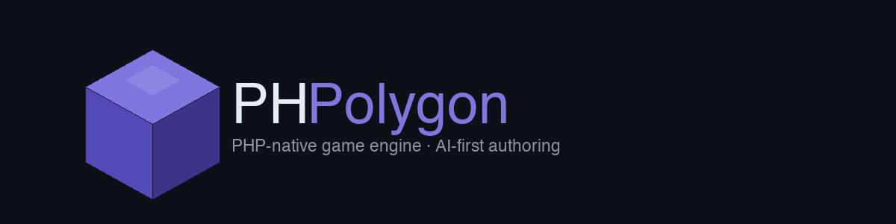

<p align="center">
  
</p>

<p align="center">
  <strong>PHP-native game engine with AI-first authoring</strong>
</p>

<p align="center">
  <a href="#features">Features</a> ·
  <a href="#architecture">Architecture</a> ·
  <a href="#getting-started">Getting Started</a> ·
  <a href="#examples">Examples</a> ·
  <a href="#documentation">Documentation</a> ·
  <a href="#roadmap">Roadmap</a> ·
  <a href="https://github.com/sponsors/phpolygon">Sponsor</a>
</p>

---

PHPolygon is a standalone game engine written entirely in PHP. It uses
[php-vio](https://github.com/phpolygon/php-vio) as its unified backend for
window management, input, audio, and 2D/3D rendering; php-vio in turn renders
through Direct3D 11/12, Vulkan, Metal or OpenGL, whichever fits the machine.
Standalone renderers on [php-glfw](https://github.com/mario-deluna/php-glfw)
(OpenGL / NanoVG) and [php-vulkan](https://github.com/hmennen90/php-vulkan)
remain in the tree as legacy backends. The primary authoring tool is Claude
Code — scenes, components, geometry and game logic are generated and iterated
on through AI-assisted workflows.

## Features

- **Hybrid ECS** — Entities as PHP objects, Components with lifecycle hooks
  (`onAttach`, `onUpdate`, `onDetach`), Systems for cross-entity logic
- **Attribute-driven serialization** — `#[Property]`, `#[Range]`, `#[Hidden]`,
  `#[Serializable]` on component fields, zero manual `toJson()`/`fromJson()`
- **Scene system** — PHP-canonical scene definitions, SceneManager with
  single/additive loading, parent-child entity hierarchy, persistent entities
- **Prefabs** — Reusable entity templates as PHP classes, plus layout sockets
  (`Opening`, `MountPoint`, `MountLine`, `Zone`) so independently built level
  parts fit together
- **PHP ↔ JSON transpiler** — Bidirectional conversion for the editor pipeline;
  PHP is always the source of truth, JSON is the intermediate format
- **3D rendering** — `RenderCommandList`-driven `VioRenderer3D`: PBR materials,
  cascaded shadows, instancing, skybox and fog, procedural normal and surface
  patterns, particles, outlines, post-processing (bloom, tone mapping, colour
  grading, FXAA / MSAA / TAA, SSAO, SSR) and upscaling (FSR 1, TAAU, FSR 3.1,
  DLSS)
- **Graphics settings** — Immutable `GraphicsSettings`, persisted per player,
  first-launch calibration, adaptive quality, hardware capabilities and a
  drop-in `GraphicsOptionsPanel` (see [docs/graphics-settings.md](docs/graphics-settings.md))
- **Procedural geometry** — Meshes are generated in PHP (`BoxMesh`,
  `SphereMesh`, `CylinderMesh`, `LatheMesh`, `SweepMesh`, …); no model files
  at runtime. Vegetation, grass, terrain and character generators build on it
- **Physics** — 2D: RigidBody2D, BoxCollider2D, AABB collision detection +
  response, raycasting, trigger/collision events. 3D: `Physics3DSystem` with
  `CharacterController3D`, box, mesh and heightmap colliders, `Raycaster3D` queries
- **Navigation** — NavMesh generation, A* pathfinding and `NavMeshAgent`s
- **Input mapping** — Action-based system with named bindings (`jump`, `shoot`)
  instead of raw key codes, axis support for movement, rebinding at run time
- **Audio** — AudioManager with channel-based mixing (Master, Music, SFX, UI,
  Voice), per-channel volume/mute, spatial 3D sources, a stem player for
  layered music, offline DSP and codecs, pluggable backend interface
- **Localization** — LocaleManager with JSON translation files, dot-notation keys,
  placeholder replacement (`:param`), fallback locale, start language resolved
  from Steam or the system
- **Save system** — Slot-based SaveManager with metadata, play time tracking,
  JSON persistence
- **UI system** — Dual-paradigm: immediate-mode (UIContext) for debug overlays,
  retained-mode (Widget tree) for complex UIs with measure/layout/draw pipeline
- **Multiplayer primitives** — Transports (Steam relay, TCP, in-process
  loopback), wire protocol, host/client sessions and a serializable command bus
  in `PHPolygon\Net` and `PHPolygon\Command`
- **Build system** — 7-phase pipeline producing standalone executables: PHAR
  creation, static PHP binary (micro.sfx), platform packaging (macOS .app,
  Linux, Windows), plus a native iOS/iPadOS `.app` via embed libphp.a + Xcode
- **Headless mode** — Full engine without GPU: `EngineConfig(headless: true)`
  swaps in NullWindow, NullRenderer2D/3D, NullTextureManager for CI/testing
- **Testing** — `GameTestCase` for headless game tests against the emitted
  render commands, Playwright-style VRT with a GD software renderer, YIQ pixel
  comparison, automatic snapshot management, diff image generation
- **Profiling** — `PerfProfiler` sections, SPX / Excimer integration, a frame
  spike recorder and benchmark scenarios (see [docs/profiling.md](docs/profiling.md))
- **Math primitives** — Vec2, Vec3, Vec4, Mat3, Mat4, Quaternion, Rect, Ray
- **Splash screen** — Engine-branded "Developed with PHPolygon" splash at startup
  with fade animation, renderer info display, configurable duration, skippable;
  an optional studio splash in front of it

## Architecture

```
PHPolygon\
├── ECS\              Entity, World, Component/System interfaces, Attributes
├── Scene\            Scene, SceneManager, SceneBuilder, Prefabs, Layout sockets, Transpiler
├── Component\        Transform2D/3D, SpriteRenderer, MeshRenderer, RigidBody2D, lights, ...
├── System\           Physics2DSystem/Physics3DSystem, Renderer2DSystem/Renderer3DSystem, ...
├── Rendering\        VioRenderer2D, VioRenderer3D, RenderCommandList, Material, Quality\,
│                     PostProcess\, NullRenderer2D/3D, Camera2D, VioTextureManager, Color;
│                     legacy: Renderer2D (NanoVG), OpenGLRenderer3D, VulkanRenderer3D
├── Runtime\          VioMainWindow, VioInput, GameLoop, Clock, NullWindow, PerfProfiler;
│                     legacy: Window / Input (GLFW)
├── Geometry\         BoxMesh, SphereMesh, CylinderMesh, MeshRegistry, MeshData, ...
├── Vegetation\       Plant generator (trees, palms, bushes, hedges)
├── Terrain\          Heightmaps, terrain chunks, scatter
├── Character\        Character DNA, CharacterMeshBuilder
├── Animation\        Pose clips for part-built figures
├── Physics\          Collision2D/3D, Raycaster3D, RaycastHit2D/3D
├── Navigation\       NavMesh, NavMeshGenerator, AStarPathfinder
├── Input\            InputMap, InputAction, InputBinding
├── Audio\            AudioManager, AudioChannel, StemPlayer, Dsp\, Codec\, Speech\
├── Net\ + Command\   Transports, sessions, wire protocol, command bus
├── Locale\           LocaleManager (i18n with JSON files, fallback locale)
├── Platform\         Start-language resolution (Steam, system)
├── SaveGame\         SaveManager, SaveSlotInfo (slot-based persistence)
├── UI\               UIContext (immediate), Widget tree (retained), UIStyle
├── Math\             Vec2, Vec3, Vec4, Mat3, Mat4, Quaternion, Rect, Ray
├── Thread\           ThreadScheduler, subsystems (ext-parallel, optional)
├── Fieldtracing\     SDF primitives, volume bakers
├── Build\            GameBuilder, PharBuilder, StaticPhpResolver, PlatformPackager
├── Testing\          GameTestCase, GdRenderer2D, ScreenshotComparer, VisualTestCase
├── Support\Facades\  Static proxies (Shader, Audio, Scenes, ...)
└── Event\            EventDispatcher, scene/collision/trigger events
```

The editor (a NativePHP desktop app with a Vue SPA) lives in its own
repository, [phpolygon/editor](https://github.com/phpolygon/editor).

### Design Principles

- **PHP is canonical** — Scenes are PHP classes, version-controlled as code.
  JSON is a derived artefact for editor tooling.
- **Attribute-driven** — Component metadata (`#[Property]`, `#[Range]`,
  `#[Category]`) drives both serialization and editor UI generation.
- **No cross-boundary logic** — Components own per-entity behavior, Systems
  own cross-entity logic. Never mix the two.
- **Layered rendering** — `RenderContextInterface` base, `Renderer2DInterface`
  and `Renderer3DInterface` with `RenderCommandList` command buffers. Game code
  builds the command list; the backend executes it.
- **Game-agnostic** — The engine names no game and carries no game-specific
  values; games pass their content, presets and constants in.

## Getting Started

### Requirements

- PHP 8.5+
- [php-vio](https://github.com/phpolygon/php-vio) extension (window, input,
  audio, 2D/3D rendering) — `pie install phpolygon/php-vio` or a release binary
- Composer

Optional extensions (see `suggest` in `composer.json`): `ext-gd` for visual
regression tests, `ext-parallel` (ZTS) for multithreading, `ext-glfw` and
`ext-vulkan` for the legacy standalone renderers.

### Installation

```bash
composer require phpolygon/phpolygon
```

### Hello World

```php
<?php

use PHPolygon\Engine;
use PHPolygon\EngineConfig;
use PHPolygon\Component\Transform2D;
use PHPolygon\Component\SpriteRenderer;
use PHPolygon\Math\Vec2;

$engine = new Engine(new EngineConfig(
    title: 'My Game',
    width: 1280,
    height: 720,
));

$engine->onInit(function ($engine) {
    $player = $engine->world->createEntity();
    $player->attach(new Transform2D(position: new Vec2(640, 360)));
    $player->attach(new SpriteRenderer(textureId: 'player.png'));
});

$engine->run();
```

A 3D game sets `is3D: true`; php-vio picks the GPU backend
(`vioBackend: 'auto'`, or `'d3d12'`, `'vulkan'`, `'metal'`, …).

### Scenes

```php
use PHPolygon\Scene\Scene;
use PHPolygon\Scene\SceneBuilder;
use PHPolygon\Component\Transform2D;
use PHPolygon\Component\Camera2DComponent;

class MainMenu extends Scene
{
    public function getName(): string { return 'main_menu'; }

    public function build(SceneBuilder $b): void
    {
        $b->entity('Camera')
            ->with(new Transform2D())
            ->with(new Camera2DComponent(zoom: 1.0));

        $b->entity('Player')
            ->with(new Transform2D(position: new Vec2(100, 200)))
            ->child('Weapon')
                ->with(new Transform2D(position: new Vec2(20, 0)))
                ->with(new SpriteRenderer(textureId: 'sword'));
    }
}
```

## Examples

Games are built in separate repositories and require `phpolygon/phpolygon` via
Composer. The `examples/` directory of this repository holds runnable demos
(`php examples/<name>.php` after `composer install`):

| Example | What it shows |
|---|---|
| `vio_2d_demo.php` | Every `Renderer2DInterface` primitive: rects, circles, lines, text, transforms, scissor |
| `vio_platformer.php`, `vio_space_attack.php`, `vio_tower_defense.php`, `vio_boids.php` | Small 2D games and a flocking simulation |
| `vio_3d_shapes.php`, `vio_3d_scene.php` | Built-in geometry generators; skybox, shadows, instancing and point lights |
| `vio_prefab_cars.php`, `svg_cars.php` | Prefab modifier API; meshes converted from SVG with `bin/svg2mesh` |
| `quality_showcase.php` | The visual-quality features with live toggles |
| `dna_basics.php`, `dna_genetics.php`, `dna_characters.php` | Character DNA: decode, crossover and mutation, figures built from a strand |
| `fieldtracing_bake.php`, `fieldtracing_sdf.php`, `fieldtracing_volume.php` | SDF authoring and baking on the CPU, sphere-traced on the GPU |
| `vegetation_catalog.php`, `grass_catalog.php`, `conforming_surfaces.php` | Headless catalogues rendered to PNG: plants, grass, paths and plazas on terrain |
| `opengl_*.php`, `vulkan_*.php` | Shapes, materials, lighting, instancing and a spinning box for the legacy renderers |

The DNA basics/genetics and `fieldtracing_bake.php` examples print to the
console and need no GPU. The catalogues and `--screenshot=out.png` on the
fieldtracing demos render without showing a window. The `opengl_*` and
`vulkan_*` examples select `renderBackend3D`; with php-vio loaded the engine
still renders through `VioRenderer3D` unless `useNative3D: true` is set.

## Build System

Compile a game project into a standalone executable — no PHP installation
required on the target machine.

```bash
# Build for current platform
php -d phar.readonly=0 vendor/bin/phpolygon build

# Build for specific target
php -d phar.readonly=0 vendor/bin/phpolygon build macos-arm64

# Build all platforms
php -d phar.readonly=0 vendor/bin/phpolygon build all

# Build a native iOS / iPadOS .app (needs Xcode + libphp.a)
php -d phar.readonly=0 vendor/bin/phpolygon build ios-arm64

# Preview configuration
php vendor/bin/phpolygon build --dry-run
```

The build pipeline creates a PHAR archive, resolves a static PHP binary
(micro.sfx), concatenates them into a single executable, and packages it
for the target platform (macOS `.app` bundle, Linux directory, Windows `.exe`).
iOS is the exception: it links an embed `libphp.a` into a UIKit/Metal wrapper
and builds with Xcode - see [docs/ios-build.md](docs/ios-build.md).

Desktop targets are `macos-arm64`, `macos-x86_64`, `linux-x86_64`,
`linux-arm64` and `windows-x86_64`. `--phar PATH` builds the PHAR once and
reuses it for every later target, `--type NAME` selects a build type from
`build.json`, and `verify-build` checks a finished build against it.
`php vendor/bin/phpolygon help` lists every command.

Configure via `build.json` in your game project root. See CLAUDE.md for
full configuration reference, [docs/docker-build.md](docs/docker-build.md) for
building every platform in a container and
[docs/build-native-upscalers.md](docs/build-native-upscalers.md) for bundling
the FSR 3.1 / DLSS runtimes.

## Headless Mode

Run the engine without a GPU or display server — useful for CI, testing,
and tooling:

```php
$engine = new Engine(new EngineConfig(headless: true));
// All subsystems work: ECS, Scenes, Events, Audio, Locale, Saves
// Window → NullWindow, Renderer → NullRenderer2D/3D, Textures → NullTextureManager
// Splash screen is automatically skipped in headless mode
```

`EngineConfig(offscreen: true)` is the other option for tests: a real GPU
context whose window is never shown.

## Visual Regression Testing

Playwright-style snapshot testing with a GD software renderer:

```php
class MyGameTest extends TestCase {
    use VisualTestCase;

    public function testMainMenu(): void {
        [$engine, $renderer] = $this->renderScene(MainMenuScene::class, 'main-menu');
        $this->assertScreenshot($renderer, 'main-menu');
    }
}
```

First run saves a reference screenshot. Subsequent runs compare pixel-by-pixel
using YIQ color space. On failure, generates `*.actual.png` and `*.diff.png`
for visual inspection.

```bash
# Run VRT tests
vendor/bin/phpunit tests/

# Update snapshots after intentional changes
PHPOLYGON_UPDATE_SNAPSHOTS=1 vendor/bin/phpunit
```

See [docs/testing.md](docs/testing.md) for the test layers, `GameTestCase` and
the GPU-backed image tests.

## Documentation

- Guides and API reference: <https://phpolygon.github.io>
- [docs/graphics-settings.md](docs/graphics-settings.md) — graphics quality
  settings, calibration, upscalers, visual-quality features
- [docs/testing.md](docs/testing.md) — unit, headless and visual regression tests
- [docs/profiling.md](docs/profiling.md) — profilers, benchmarks, baselines
- [docs/dna-system.md](docs/dna-system.md) — character DNA
- [docs/docker-build.md](docs/docker-build.md), [docs/ios-build.md](docs/ios-build.md),
  [docs/build-native-upscalers.md](docs/build-native-upscalers.md) — builds
- [docs/gameplay-architecture.md](docs/gameplay-architecture.md) — combat core
  and genre hulls
- [docs/rfcs/](docs/rfcs/) — design records (MRT G-buffer, compute pipeline)
- `CLAUDE.md` — the full engine reference used for AI-assisted authoring

## Roadmap

| Phase | Description | Status |
|-------|-------------|--------|
| 1 | Engine foundation — ECS, runtime, rendering, math | Done |
| 2 | Scene system — SceneManager, hierarchy, prefabs, transpiler | Done |
| 3 | Game systems — physics, collision, input mapping, audio | Done |
| 4 | Editor infrastructure — inspector, registry, commands, NativePHP desktop app (now [phpolygon/editor](https://github.com/phpolygon/editor)) | Done |
| 5 | Engine services — localization, save system, audio manager, UI system | Done |
| 6 | Build & test — build pipeline, headless mode, visual regression testing | Done |
| 7 | 3D pipeline — OpenGL and Vulkan backends, RenderCommandList, shadows, instancing | Done |
| 8 | php-vio — unified backend for window, input, audio, 2D/3D rendering (Direct3D 11/12, Vulkan, Metal, OpenGL) | Done |
| 9 | First game — engine validation through real-world usage | Done (shipped on Steam) |

## Testing

```bash
composer install
vendor/bin/phpunit
vendor/bin/phpstan analyse
```

The suite covers ECS, math, serialization, the scene system, physics,
navigation, input, audio, localization, the save system, UI, rendering, the
build pipeline, the headless engine and visual regression testing. Tests that
need a GPU skip when no php-vio context can be opened; CI excludes the
font-dependent snapshots with `--exclude-group font-vrt`.

## License

MIT
